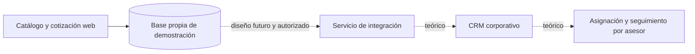

# Informe y manual de demostración — B2 Solutions D4 y D5

**Estado:** implementación local para demostración académica. Los servicios, precios, empresas y registros de prueba son ficticios. La base local configurada no respondió durante la revisión; las migraciones y el despliegue de Render requieren validación en el entorno real. La revisión visual en navegador y la captura de evidencias siguen pendientes.

## Objetivo y alcance

El canal ayuda a una MYPE a explorar ofertas referenciales de portabilidad, internet y equipos, compararlas, seleccionar cantidades y registrar una cotización. Una propuesta consultable desde un enlace aleatorio permite abrir WhatsApp con un borrador, registrar preferencia de llamada, responder una encuesta y compartir un referido. El panel interno protegido muestra conteos agregados de solicitudes y respuestas de prueba.

El número de WhatsApp de prueba configurado por defecto es **+51 974 368 162**; se puede reemplazar mediante `B2_WHATSAPP_DEMO` en formato internacional sin espacios ni `+`. El usuario confirma manualmente cualquier envío. La preferencia de llamada es solo un registro: no se llama ni se asigna una persona. El campo `B2_EJECUTIVO_DEMO` representa un nombre ficticio y no una asignación real.

## Arquitectura y conservación de datos

Laravel y Blade usan catálogo local `config/catalogo_b2.php`. El carrito, comparador y referencia se conservan en `sessionStorage` de la pestaña. Al enviar, Laravel valida cantidades y obtiene los precios del catálogo; `solicitudes_cotizacion` almacena datos empresariales ficticios, origen, ofertas, precios de demostración y hash del token de recuperación. `solicitudes_contacto_demo` almacena preferencia y procedencia; `encuestas_demo` guarda una valoración por solicitud. Los importes mensuales y únicos se mantienen separados.

La URL de propuesta contiene un token aleatorio, no datos personales. Quien posea el enlace puede acceder a su resumen y acciones; no lo publique. La referencia es otro código aleatorio. El enlace no autentica la identidad de su portador; esta solución es para pruebas, no para datos reales. Si se pierde el enlace no hay una recuperación alternativa implementada.

## Flujo para una demostración

1. Abrir el inicio, entrar al catálogo, elegir una categoría y abrir una ficha.
2. Comparar como máximo dos opciones de la misma categoría. Añadir una o varias ofertas al carrito y ajustar cantidades.
3. Solicitar cotización con datos ficticios; comprobar RUC de 11 dígitos, teléfono de 9 a 15 dígitos y cantidades de 1 a 99.
4. Guardar la solicitud y copiar la URL de propuesta. Abrirla en otra sesión o navegador y verificar el mismo código y resumen.
5. Abrir WhatsApp y revisar el borrador; la aplicación no envía el mensaje. Registrar una preferencia de llamada y comprobar el aviso de demostración.
6. Completar la encuesta y compartir el enlace de referido. Abrirlo en otra pestaña, explorar el catálogo y registrar una nueva solicitud en esa misma pestaña. La nueva solicitud guardará el origen referido.
7. Ingresar a `/interno/metricas` con usuario `admin` y la clave de entorno `B2_METRICAS_CLAVE` (mínimo 16 caracteres). Se muestran conteos, no datos de contacto, ventas ni renovaciones.

## Indicadores y supuestos

- Solicitudes por fecha y origen: número de solicitudes registradas. Orígenes: web o referido.
- Ofertas por categoría: número de líneas de oferta en solicitudes; una solicitud puede contribuir a varias categorías. No son ventas ni unidades vendidas.
- Referidos: solicitudes cuya referencia apunta a otra solicitud existente.
- Satisfacción: distribución de valoraciones de 1 a 5. Cada propuesta mantiene una sola respuesta, que puede actualizarse.
- El catálogo y los precios son supuestos de demostración. La disponibilidad, factibilidad técnica y validez comercial no se comprueban.
- Presupuesto académico referencial: no estimado; requiere tarifas, horas y costos acordados por el equipo. No se inventan montos.
- Relación con Marketing 5.0: el prototipo organiza información y permite continuidad digital con supervisión humana; no aplica inteligencia artificial ni automatización comercial.

## Integración futura con CRM: solo teoría

El diagrama anexo se encuentra en `DIAGRAMA_CRM_TEORICO.svg`.

Campos candidatos: identificador de solicitud, fecha, procedencia, referencia comercial, servicios, cantidades, preferencias y datos de contacto autorizados. El equipo del canal sería responsable del registro y validación; una integración futura requeriría coordinación, autorización, definición de seguridad y acuerdo de campos con el equipo del CRM. No existe conexión, sincronización ni acceso al CRM corporativo.

## Validación y lista de cierre

- Pruebas automatizadas: `php artisan test --filter=CatalogoB2Test`, `--filter=CotizacionTest`, `--filter=ContinuidadTest`, y los scripts `node tests/js/*.cjs` individualmente.
- Comprobar registro, token incorrecto, recarga, WhatsApp, contacto, encuesta, referido y acceso rechazado a métricas; usar exclusivamente datos ficticios.
- Verificar que el número de prueba, clave interna, conexión y migraciones estén configurados en cada entorno, sin compartir secretos.
- Pendiente: aplicar migraciones sobre la base elegida, validar MySQL o PostgreSQL real, revisar pantalla móvil y escritorio, y capturar evidencias; luego ensayar la presentación y verificar un respaldo.
- Alternativa local: arrancar MySQL del proyecto, aplicar las dos migraciones específicas y ejecutar `php artisan serve`. Render requiere una base persistente externa; ver `GUIA_BASE_DATOS.md`.

## Guion breve de presentación

1. Explicar el problema de una MYPE que desea comparar a su ritmo.
2. Mostrar catálogo y comparación, indicando que precios y servicios son ficticios.
3. Registrar una cotización de prueba y abrir su propuesta desde otra sesión.
4. Mostrar el borrador de WhatsApp sin enviarlo y registrar la preferencia de llamada.
5. Responder la encuesta, compartir el referido y comprobar el origen en métricas internas.
6. Aclarar que CRM es una integración teórica y mostrar qué falta para cerrar la validación.
